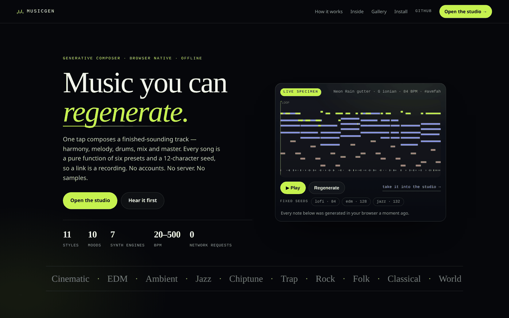
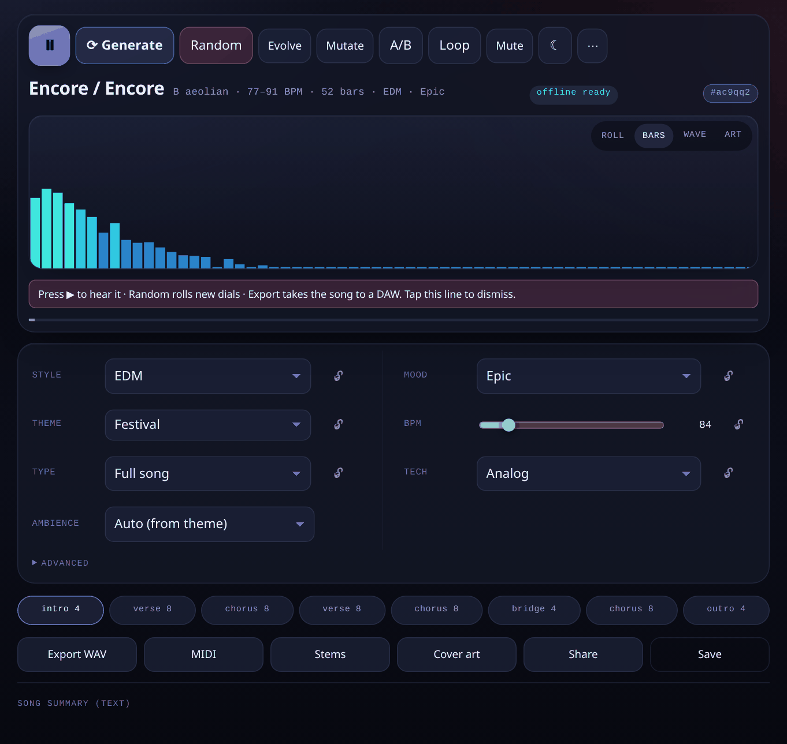
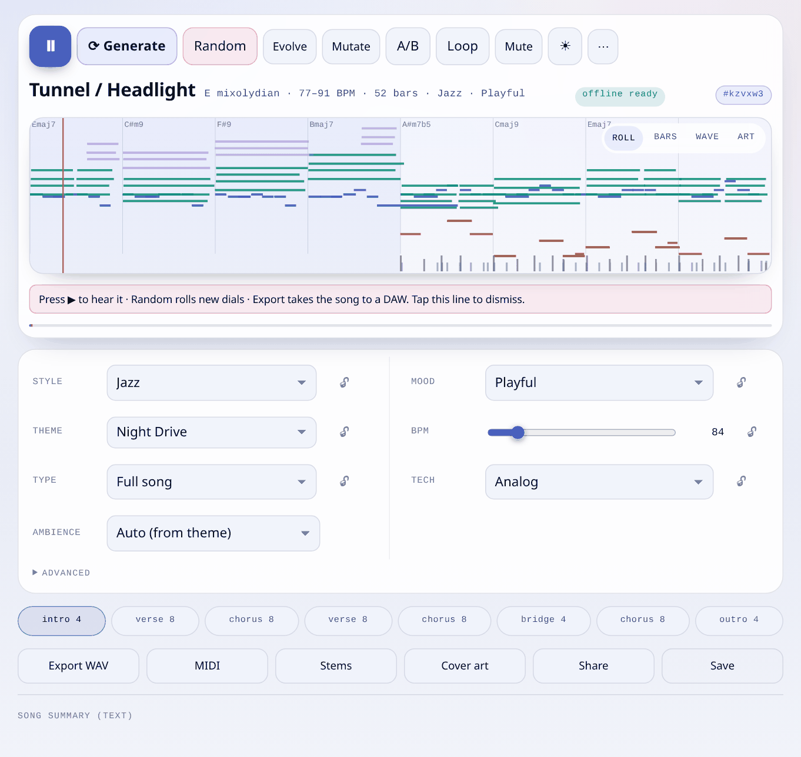
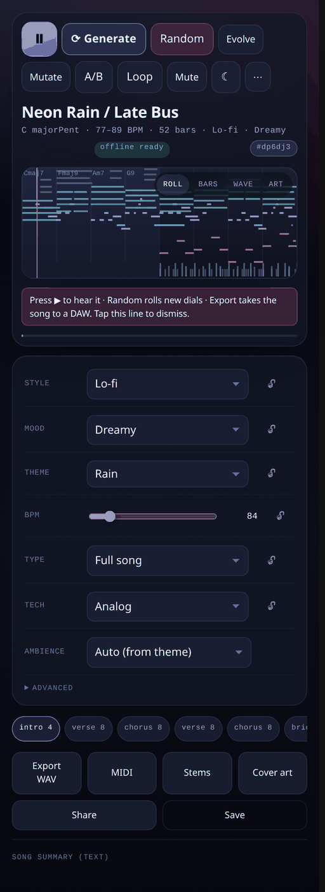
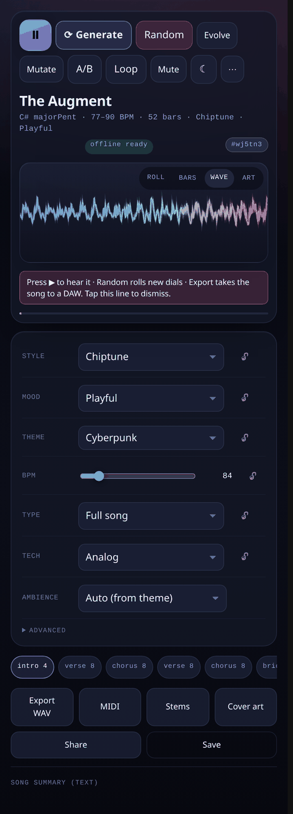
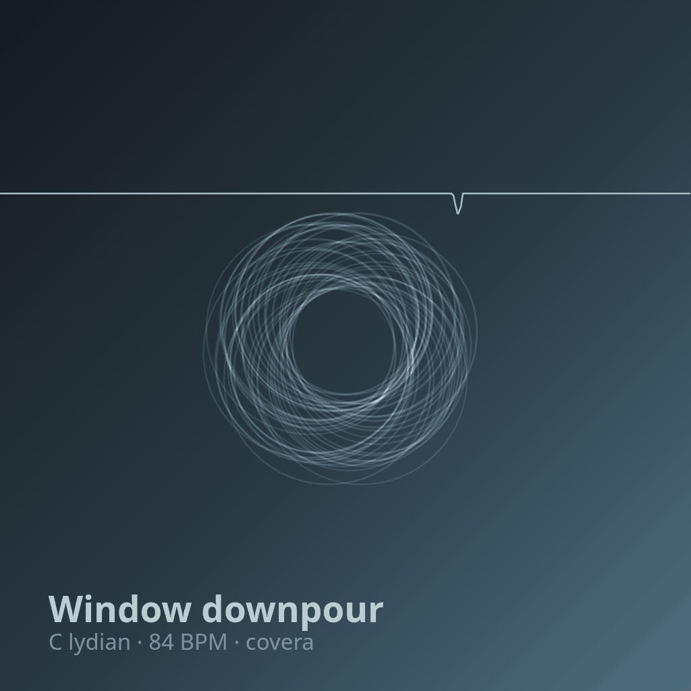

# MusicGen

**A pocket generative composer.** One tap makes a finished-sounding track — harmony, melody, drums, mix and master — from six presets and a 12-character seed. No accounts, no server, no samples. It runs entirely in your browser, offline, in a light or dark studio.

[](https://github.com/drsamonline/musicgen/actions/workflows/test.yml)
[](#accessibility--audit)
[](LICENSE)
[](#)
[](#)
[](#)
[](#)
[](#)

**[▶ Live demo](https://drsamonline.github.io/musicgen/)** · **[Open the studio](https://drsamonline.github.io/musicgen/app/)** · **[Releases](https://github.com/drsamonline/musicgen/releases)** · **[Enhancement backlog](docs/ENHANCEMENTS.md)**



---

## What it is

A generative composer that behaves like an instrument rather than a toy. Every song is a **pure function of `(presets, seed)`**: the same inputs produce a byte-identical song, so a link is a recording. Random is sampled through a compatibility table so it stays musical, and every note is checked against the key and the chord sounding under it.

The whole thing is vanilla ES modules and the Web Audio API — no framework, no build step, no audio files, no network requests at runtime.

| Dark | Light |
|---|---|
|  |  |
| *Two columns of dials, live spectrum, section timeline* | *The same studio in light — canvas colours are tokens too* |

| | | |
|---|---|---|
|  |  |  |
| *Phone: piano roll, chord labels, playhead* | *Waveform mode* | *Cover art from the song's own data* |

## Try it

```bash
git clone https://github.com/drsamonline/musicgen
cd musicgen/app
python3 -m http.server 8080
# → http://localhost:8080
```

Then use your browser's **Install** / **Add to Home Screen** (iOS: Share → Add to Home Screen). The service worker precaches the whole shell, so after that first visit it launches and plays with the network switched off.

## What's inside

**The composer** — eleven stages, each testable: key and mode → harmonic grid (2nd-order Markov over style progressions, modal interchange) → voicing with a voice-leading solver → bass → drums (groove templates, Euclidean layers, phrase fills) → motif → development transforms → pad and counter-line → arp → humanise → tension curve.

**The presets** — every axis has a **None**: no genre, no mood bias, no theme, no form, plain sine tones — so you can strip the song back to the notes and add only what you want. 11 styles, 10 moods, 10 themes, 8 song types, 7 synthesis technologies, plus a compatibility table that maps styles to allowed moods and engines. Tempo is a **map, not a number**: choruses lift, verses settle, every phrase gets a little rubato and the last two bars ease off, so a song breathes instead of clicking along. The BPM dial sets the centre and *Tempo drift* sets how far it may wander (0–35%). Range: **20–500 BPM**; per-track locks freeze the drums or the melody while you reroll everything else. Every share link carries the composer version, so an old seed can tell you it will sound different instead of silently lying.

**The ambience** — eight synthesised textures (rain, wind, fire, vinyl, crickets, ocean, stream, hum) with its own **Ambience dial**: *Auto* follows the theme, *None* is silence, or you pick one outright. Sitting under the arrangement with slow LFO movement and sparse droplets/crackles. Plus section transitions: a noise riser into every lift and a soft impact on the downbeat.

**The synthesis** — subtractive, FM, chiptune (real `PeriodicWave` pulses), additive, a six-frame **wavetable with a real morph**, Karplus-Strong, a **formant/vowel** layer and noise instruments, plus two **AudioWorklet** engines (granular and a waveguide) with native fallbacks; a drum kit built from oscillators and filtered noise; generated convolution reverb, tempo-synced delay and chorus; glue compressor and limiter on the master, mono bass below 120 Hz, sidechain ducking for EDM, a filter envelope and velocity-to-timbre on every voice, analogue drift, and a stereo-width tap. A voice pool steals the quietest voice with a fade; the scheduler runs a 200 ms lookahead and skips late notes instead of firing them in a burst.

**MIDI both ways** — export the song as Type-1 MIDI, or **import a MIDI file as the theme**: the highest-register line becomes the song's idea and everything derives from it.

**The exports** — WAV (16/24/32-bit, normalised to a chosen loudness target under a −1 dBTP ceiling), per-track stems as a zip with per-stem loudness in the readme, Type-1 MIDI, full song JSON (export *and* import), 1024 px cover art, and seed links that reproduce the exact song elsewhere.

**The platform bits** — installable PWA with a real install prompt and an offline badge, MediaSession metadata with generated artwork, screen Wake Lock, four visualisers, a piano roll you can zoom, pan and scrub, section looping, A/B against the previous song, undo/redo, a library with search/rename/duplicate, session restore, a text song summary for screen readers, `prefers-reduced-motion` and `prefers-color-scheme` support, and a strict CSP (`default-src 'self'`) with zero runtime fetches.

## Themes

The studio ships **light and dark**, and the choice is yours, not the OS's: the ◐ button (or `T`) cycles **system → light → dark** and the choice is remembered. Every surface is a token, including the canvas palettes — the piano roll, spectrum, waveform and generative-art modes re-theme with the UI rather than staying stuck on one background.

## Accessibility & audit

`npm run audit` runs axe-core (WCAG 2.1 A/AA + best practice) over the studio in **dark, light and desktop**, and over the landing page, then adds app-level checks axe cannot know about: duplicate ids, unlabelled controls, canvases without an accessible name, missing `lang`, console errors. Current state: **zero violations, zero app-level issues, zero console errors**.

```bash
npm install --no-save axe-core puppeteer   # audit + screenshot tooling only
npm run audit
```

## Tests

```bash
npm test              # 47 unit tests, no browser needed
npm run test:browser  # 104 tests in real Chromium with real Web Audio
npm run lint          # determinism lint: no Math.random / Date.now in pure modules
npm run budget        # shell size, precache completeness, no external requests
npm run visual        # pixel-diff the studio against committed baselines
npm run shots         # regenerate docs/screenshots
npm run audit         # axe + app checks, light and dark
```

The suite asserts, rather than claims:

- determinism — the composer run 100× on the same seed, diffed
- musicality — 330 style × mood × seed cases through the theory validator
- audio — an offline render measured for silence, clipping and LUFS against the style target
- exports — WAV byte length, MIDI header and track count, zip archive structure
- continuity — a 3-second playback run whose event cursor must keep advancing, plus a watchdog test
- anti-aliasing — partial counts asserted against Nyquist at 22.05/44.1/48 kHz
- clipping — master peak ≤ 1.0 and no sample-to-sample jump above 0.9 in a dense render
- worklets — both processors render audio and the modules load in an offline context
- tempo — 20 BPM and 500 BPM both compose, render and validate; the range is clamped at both ends
- variable tempo — the map integrates and inverts, every scheduled event matches `secondsAt(beat)`, the render length equals the song's duration, and each section can sit at its own BPM
- audio integrity — a dense render has no silent holes, no voices are dropped, the pool stays inside its cap at 7/8 and 500 BPM
- loudness regression — three styles rendered offline and checked against their LUFS target and peak ceiling
- mix balance — every track rendered solo, checked for being audible, not buried, and not letting the drums dominate
- the app — theme switching and persistence, service worker caching, visualiser modes painting, stems quieter than the mix, track locks surviving a new seed
- the landing page — composing, drawing and linking its specimen

## Mix balance (why it sounds like a mix)

Per-track loudness is measured, not eyeballed: the drum bus has its own compressor, every track has a measured trim, and `npm run test:browser` renders each track solo and fails if anything is buried more than 18 dB or if the bass sits more than 12 dB over the drums. That test exists because the bass *did* sit 18 dB over the drums in v2.2.0, and it was the difference between "a song" and "a bass solo".

## Performance: why it stopped stuttering

Three things were fighting for the main thread, and the fix was structural rather than tuning:

- **The scheduler now runs off the audio thread.** The clock worklet had never actually attached — `AudioWorkletNode` rejects `numberOfOutputs: 0`, so the constructor threw and the app silently fell back to `setInterval`, which stutters whenever the main thread is busy. It now has one output and a silent sink, and ticks arrive from the audio thread. Lookahead went from 200 ms to 300 ms, and a note is only dropped if it is more than 150 ms late.
- **The visualisers are two layers.** Everything static in the piano roll (grid, chord labels, ~1,500 notes, drum lane) is rendered once into an offscreen canvas and blitted; only the section band and the playhead are drawn per frame. Measured cost of one visualiser frame: **0.08 ms**, down from several milliseconds. The landing page's specimen got the same treatment.
- **30 fps, not 60.** The render loop was already capped; with the blit it now has room to spare, and `prefers-reduced-motion` drops it to 10 fps.

## Performance and audio integrity

Measured, not guessed. The reverb IR is synthesised once per context and cached (it used to be rebuilt on every pause); the saturation curve is a shared `Float32Array` instead of 1024 floats per note; analyser buffers are reused across frames; the section-intensity lookup is a binary search; and pausing fades the master instead of rebuilding the graph.

Three bugs used to make sound drop out, and they are worth naming because they were invisible:

1. **The voice counter never decremented.** It ran on `setTimeout`, which is throttled in a background tab and never fires during an offline render — so `active` hit the cap and stayed there, and from then on every quiet note was silently dropped. It is now a pool pruned by time, stealing the quietest voice with a fade.
2. **Feedback loops were never disconnected.** Karplus-Strong's delay line rang forever and the noise bed's LFO kept running; over a long session that is a CPU creep that ends in dropouts.
3. **Late notes were fired in a burst.** Anything more than 60 ms late is now skipped instead of dumped into the present.

## Architecture

```
index.html            landing page (its own live specimen)
landing.css landing.js
app/                  the PWA
  index.html styles.css manifest.webmanifest sw.js icons/
  src/core/           rng algorithms theory voicing motif composer validate
  src/presets/        styles moods themes types techs compatibility
  src/audio/          engine instruments drums fx mastering lufs
  src/export/         wav midi zip artwork
  src/visual/         pianoRoll (+ bars, waveform, generative art)
  src/state.js        src/main.js
  qa/matrix.html      listening matrix (dev only)
tests/unit/ tests/browser/
scripts/              screenshots.mjs, audit.mjs
docs/ENHANCEMENTS.md  the backlog
```

## Credits and licences

Two of my own other repositories informed this one. **ambient-sound-studio** (personal-use licence) is where the idea of layered synthesised textures comes from — the eight beds here are reimplemented for this engine, not copied. **eon-commando** (same) contributed the noise-sweep primitive that became the section risers. **audio-kit** (PolyForm Noncommercial) shares the same "patterns, not files" philosophy; its code is deliberately *not* vendored here, because mixing licences in one bundle is a trap.

## Layout

Two splits, both done for editability rather than tidiness.

**The engine** is five modules behind a barrel (`engine.js`): `worklets.js` (AudioWorklet loading and fallbacks), `graph.js` (track chains, buses, master chain), `scheduler.js` (tempo map, events, automation, voice dispatch), `player.js` (live transport) and `render.js` (offline rendering).

**The UI** is six modules behind `main.js` (205 lines of wiring and nothing else): `ui/ctx.js` (the DOM map, the mutable singletons, the small helpers), `ui/dials.js` (presets, random/evolve/mutate, groove editor), `ui/generate.js` (history, compose, the three readouts), `ui/transport.js` (player lifecycle, loop, A/B, wake lock, MediaSession, install), `ui/visuals.js` (theme, four visualisers, piano-roll gestures) and `ui/exporters.js` (WAV, stems, MIDI, JSON, art, share, library, recording).

## Contributing

`CONTRIBUTING.md` has the one rule that matters (determinism in `src/core/`) and the five checks a PR must pass. `docs/LISTENING.md` is the golden-seed log — the place where the automated tests stop and a person listens.

## Design notes

Three decisions are worth knowing about, because they were made against the obvious choice:

**The validator accepts chromatic notes when the chord owns them.** An absolute "everything in the key" rule would reject the modal interchange and borrowed chords that make the harmony interesting. The rule is *in key **or** a tone of the chord sounding at that moment*.

**Loudness targets are per style.** Lo-fi sits at −16 LUFS, EDM at −11, Ambient at −18. Normalising everything to a single streaming number would flatten exactly the character the styles are for.

**Worklets arrived last, not first.** Granular and waveguide processors exist now, but every one of them is a per-track node with a native fallback, and the app still runs with `addModule` unavailable. Building the whole synth on worklets first would have made the fallback the interesting case instead of the exception.

## Known gaps

Stems share one gain (measured on the mix) rather than being re-mixed per track — the per-stem loudness is written into the zip's readme; undo covers preset changes, not generations; note audition and a groove editor are not implemented; granular and physical modelling remain native-node approximations rather than AudioWorklets; MIDI import, microtuning, a share target and a protocol handler are still open. The full backlog, with what is done and what is not, is in [docs/ENHANCEMENTS.md](docs/ENHANCEMENTS.md).

## License

PolyForm Noncommercial 1.0.0 — see [LICENSE](LICENSE). Music you generate with it is yours.
